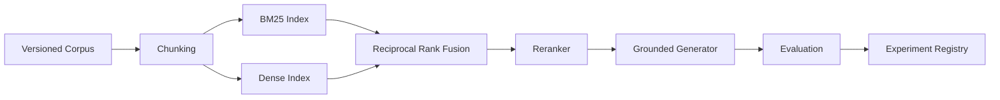

# Retrieval Systems Lab

A reproducible laboratory for comparing sparse, dense and hybrid retrieval on one versioned corpus and fixed query set. It includes reranking, grounded answer generation, evaluation, ablations, robustness checks and an experiment registry.

## Capabilities

- Versioned corpus pipeline with deterministic chunk identifiers
- Configurable chunk size and overlap
- BM25 lexical retrieval
- Hashing-based dense semantic retrieval
- Reciprocal rank fusion for hybrid search
- Pairwise query-passage reranking
- Evidence-only answer generation with citations and abstention
- Recall@k, MRR, nDCG, answer correctness, groundedness and citation evaluation
- Chunking and reranking ablations with a quality-latency Pareto frontier
- Query perturbation robustness analysis
- Experiment lineage, caching, telemetry and REST APIs

## Architecture



## Quick start

Requires Python 3.10 or newer and has no runtime dependencies.

```bash
python -m venv .venv
pip install -e .
retrieval-lab
```

The CLI evaluates BM25, dense and hybrid plus reranking against the bundled synthetic corpus. It writes experiment records under `artifacts/`. Results are local demonstration measurements, not production benchmark claims.

Start the API:

```bash
python -c "from retrieval_lab.api import serve; serve()"
```

Endpoints:

- `GET /health`
- `GET /search?q=hybrid+retrieval&method=hybrid&top_k=5`
- `GET /answer?q=how+does+reranking+work`

## Evaluation design

The fixed query set maps each question to relevant documents and expected answer terms. Retrieval evaluation reports recall@k, mean reciprocal rank and nDCG. Generation evaluation checks expected terms, groundedness and whether every citation belongs to the retrieved context.

`AblationRunner` varies chunk size, overlap and reranking, then identifies non-dominated quality-latency configurations. `RobustnessEvaluator` measures rank stability under word deletion, swaps, synonyms and normalization.

## Cloud deployment

Deploy the API on Cloud Run, Azure Container Apps, AWS ECS or Kubernetes. Use `python -c "from retrieval_lab.api import serve; serve()"` as the start command and `/health` as the probe. For a larger corpus, replace in-memory indexes with OpenSearch, Pinecone, pgvector or FAISS and store corpus versions in object storage.

Use platform-managed configuration based on `.env.example`. No credentials are required by the included implementation.

## Data provenance

The included corpus and evaluation queries are generated by this repository and MIT licensed. They contain no employer, client, university or private data.

## License

MIT
